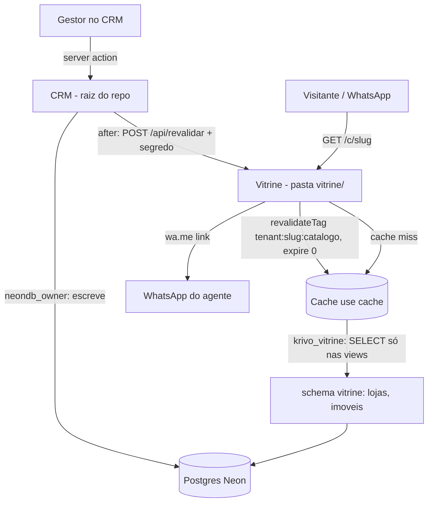

# Lote 16 — Vitrine pública do catálogo — Design

**Specs**: `lote-16a-vitrine-lado-crm/spec.md`, `lote-16b-vitrine-app/spec.md`, `lote-16c-vitrine-ativacao/spec.md`
**Context**: `lote-16-vitrine-publica/context.md`
**Status**: Approved (usuário, 2026-10-09)
**ADs**: conforma AD-002, AD-004, AD-007, AD-010, AD-014, AD-021, AD-028, AD-029, AD-033; **emenda AD-025** (AD-040, AD-042); cria AD-040 a AD-043; **AD-046** emenda a AD-025 no mecanismo de entrega do tema (L16b, 2026-10-10).

---

## Architecture Overview

Dois projetos Next no mesmo repositório, um banco, duas identidades de banco.



- **O CRM continua como está** (AD-007: RSC-first, `cacheComponents` desligado). Ganha uma tabela,
  uma coluna, uma seção em Configurações, um toggle em Imóveis e um cliente HTTP de revalidação.
- **A vitrine** (`vitrine/`) é um Next 16.2.11 com `cacheComponents: true`, sem `proxy.ts`, sem
  autenticação, sem escrita. Lê só pelo papel `krivo_vitrine`, que só enxerga duas views.
- **A fronteira de segurança é o banco**: o papel não tem privilégio em nenhuma tabela de `public`;
  as views já aplicam o corte de visibilidade (loja ativa com CRECI, imóvel `disponivel` e publicado)
  e expõem só colunas públicas. Um bug na vitrine não consegue ler `leads`, endereço do imóvel,
  captador nem imóvel vendido.

### Alternativas consideradas (decididas com o usuário em 2026-10-09 ou por AD)

| Eixo | Escolhido | Rejeitado e por quê |
| --- | --- | --- |
| Projeto | Pasta `vitrine/` | Repositório novo: duplica testes de banco, ferramentas e regras; divergência de schema invisível |
| Fronteira de banco | 2 views + papel SELECT-only nas views | `GRANT` por coluna em `properties`/`tenants`: o papel leria imóvel vendido e não publicado; o corte ficaria só no código |
| Revalidação | Rota com segredo + `expire: 0` | Só cache curto (vendido no ar ~5 min sempre); API de tags da Vercel (token de projeto no CRM) |
| Dados | Tabela `tenant_storefronts` 1:1 | Colunas em `tenants` (tabela já mistura auth, baseline e saúde) |
| Fotos | URL externa direta | Otimizador do Next (proxy aberto para qualquer host + cota Hobby); OG composto com a foto (busca de URL arbitrária no servidor) |

---

## Code Reuse Analysis

### Existing Components to Leverage

| Component | Location | How to Use |
| --- | --- | --- |
| Tabela `properties`, enums `propertyKindEnum`/`propertyStatusEnum`/`modalityEnum` | `src/db/schema.ts:41`, `:54`, `:28`, `:1077` | Base da view `vitrine.imoveis`; ganha `featured` |
| Definição única de visibilidade (`disponivel` E publicado) | spec do L11, IMOV-05 AC3 | A view `vitrine.imoveis` é a **segunda** implementação; teste de paridade com a do contrato `/api/v1` |
| Server actions de imóvel com `revalidatePath` | `src/server/actions/properties.ts:164`, `:307`, `:328`, `:355`, `:386` | Pontos exatos onde entra o agendamento da revalidação |
| Matriz de permissões | `src/lib/permissions.ts` | `configuracoes:escrever` (Vitrine) e `imoveis:escrever` (destaque); nada novo na matriz |
| Configurações e `SettingsForm` | `app/(crm)/configuracoes/page.tsx`, `src/components/settings/settings-form.tsx` | Nova seção em Card de settings, mesmo padrão de `BaselineForm` |
| Ação de configurações do tenant | `src/server/actions/settings.ts` | Passa a agendar revalidação e a recusar apagar o WhatsApp com vitrine ativa |
| Conexão por worker | `src/db/test-connection.ts:22` | Mesma derivação de URL para o papel `krivo_vitrine` (troca usuário/senha) |
| `db:push:test` | `scripts/test-db-push.ts` | Passa a fazer: derrubar schema `vitrine` → `drizzle-kit push` → aplicar SQL da vitrine, em cada alvo |
| Padrão de mock de `next/cache` em testes de action | `src/server/__tests__/properties-actions.test.ts:41` | Mesmo padrão para `next/server` (`after`) |
| Seed determinístico | `src/db/seed.ts` | Vitrine ativa para um tenant do seed, inativa para outro, destaques |
| Templates Astryx | `npx astryx template product-gallery`, `centered-hero`, `side-gallery`, `product-detail` | Referência de composição dos dois layouts e da página de item |
| `Theme`, `defineTheme`, `generateThemeCSS`, `resolveThemeTokens` | `@astryxdesign/core/theme`, `@astryxdesign/theme-neutral` | Tema por loja derivado do neutro (`extends`); CSS do tema emitido no HTML do servidor (AD-046) |

### Integration Points

| System | Integration Method |
| --- | --- |
| Postgres (CRM) | Drizzle, papel dono, schema `public` (inalterado) |
| Postgres (vitrine) | `pg` + Drizzle com `pgView(...).existing()` no schema `vitrine`, papel `krivo_vitrine` |
| CRM → vitrine | `POST {VITRINE_PUBLIC_URL}/api/revalidar`, `Authorization: Bearer {VITRINE_REVALIDATE_SECRET}`, corpo `{"slug": "..."}` |
| Vitrine → WhatsApp | Link `https://wa.me/<dígitos>?text=<mensagem codificada>` |
| Vitrine → robôs de prévia | `generateMetadata` (OG/Twitter) + `opengraph-image` gerado com `next/og` |

---

## Components

### L16a — lado CRM

#### Schema (`src/db/schema.ts`)

- **Purpose**: guardar a configuração da vitrine e o destaque.
- **Interfaces**: `storefrontLayoutEnum` (`grade`, `editorial`), `storefrontFontEnum` (`inter`,
  `montserrat`, `lora`, `playfair`), tabela `tenantStorefronts`, coluna `properties.featured`.
- **Reuses**: padrão de check constraint de `tenants` (`:201`).

#### SQL da vitrine (`scripts/vitrine/vitrine.sql` + `scripts/vitrine/apply.ts`)

- **Purpose**: garantir os checks de `tenant_storefronts` (o `drizzle-kit push` não aplica check,
  Handoff do L15), criar/atualizar schema `vitrine`, as duas views, o papel `krivo_vitrine` e os
  grants. Idempotente.
- **Interfaces**: `applyVitrineSql(url, { password? })`; `dropVitrineSchema(url)`.
- **Dependencies**: `pg`. A senha do papel vem de variável do ambiente local nos alvos de teste e
  **nunca** é definida pelo script em produção (L16c: o usuário define no console SQL).
- **Reuses**: `scripts/test-db-push.ts` chama `drop → push → apply` em cada alvo.

#### Contrato espelhado (`src/lib/storefront-contract.ts`)

- **Purpose**: o que precisa ser igual dos dois lados.
- **Interfaces**: `storefrontCacheTag(slug)` → `tenant:<slug>:catalogo`; `STOREFRONT_LAYOUTS`;
  `STOREFRONT_FONTS`; `RevalidationRequest = { slug: string }`; `STOREFRONT_VIEW_COLUMNS` (nome e
  ordem das colunas de cada view).
- **Reuses**: espelho em `vitrine/src/contrato.ts` (L16b); teste de paridade importa os dois.

#### Validação pura (`src/lib/storefront.ts`)

- **Purpose**: validar o formulário e decidir se a vitrine pode ser ativada.
- **Interfaces**: `validateStorefrontInput(input) → { ok: true, value } | { ok: false, field, message }`;
  `activationBlockers({ storefront, agentWhatsapp }) → Blocker[]` (lista ordenada, vazia = pode
  ativar); `normalizeInstagram`, `normalizePhoneDigits`, `normalizeAccent`.
- **Reuses**: padrão de função pura de `src/lib/permissions.ts`.

#### DAL (`src/server/data/storefront.ts` e `src/server/data/index.ts`)

- **Interfaces**: `getStorefront(tenantId) → Storefront` (defaults quando não há linha);
  `saveStorefront(tenantId, value)` (upsert, `updated_at`); `setPropertyFeatured(tenantId, id, featured)`;
  `getTenantSlug(tenantId)`.
- **Reuses**: filtro por tenant ativo (AD-002); teste com linha de outro tenant (L-035).

#### Cliente de revalidação (`src/server/storefront/revalidation.ts`)

- **Interfaces**: `requestStorefrontRevalidation(slug, deps?) → Promise<"enviado" | "ignorado" | "falhou">`;
  `scheduleStorefrontRevalidation(tenantId)` em `src/server/storefront/schedule.ts` (registra `after()`
  que resolve o slug e chama a função).
- **Regras**: sem `VITRINE_PUBLIC_URL` ou sem segredo → `"ignorado"` e um log `info`; timeout 3 s;
  resposta não-2xx ou exceção → `"falhou"` e um log `warn` com slug, status ou nome do erro; nunca
  lança; nunca registra o segredo.

#### Server actions

- `saveStorefrontAction` (novo, `src/server/actions/storefront.ts`): `configuracoes:escrever`,
  validação, bloqueios de ativação, gravação, revalidação.
- `setPropertyFeaturedAction` (novo, em `src/server/actions/properties.ts`): `imoveis:escrever`.
- As 5 actions de imóvel e a de configurações do tenant passam a agendar a revalidação.

#### UI

- `src/components/settings/storefront-form.tsx`: Card "Vitrine" em Configurações. Campos: Switch
  "Vitrine publicada", SegmentedControl de layout, campo de cor (TextInput com validação de hex e
  amostra por Token), Selector de fonte, CRECI, razão social, título, sobre (TextArea), Instagram,
  telefone, endereço; lista de bloqueios de ativação; link "Abrir vitrine" quando ativa.
- Destaque: Switch no `property-form-dialog.tsx` e marcador na lista de Imóveis (Token "Destaque").

### L16b — projeto `vitrine/`

```
vitrine/
  package.json            next 16.2.11, react 19.2.4, @astryxdesign/core, @astryxdesign/theme-neutral,
                          drizzle-orm, pg, server-only, tailwindcss (mesmas versões do CRM)
  next.config.ts          cacheComponents: true; cacheLife.vitrine; headers (X-Robots-Tag, Referrer-Policy)
  vercel.json             ignoreCommand (só se a F16 confirmar)
  app/layout.tsx          reset.css + astryx.css; <html lang="pt-BR">; metadata.robots noindex
  app/not-found.tsx       não encontrado neutro, sem marca de loja
  app/c/[slug]/layout.tsx           Suspense → carrega a loja → <Theme> da loja + cabeçalho + rodapé legal
  app/c/[slug]/not-found.tsx        "Imóvel indisponível" com a marca da loja e link para o catálogo
  app/c/[slug]/page.tsx             catálogo (template grade | editorial), paginação ?pagina=
  app/c/[slug]/opengraph-image.tsx  cartão gerado (nome + cor), sem fetch externo
  app/c/[slug]/imovel/[ref]/page.tsx  página de item
  app/api/revalidar/route.ts        POST com segredo → revalidateTag(tag, { expire: 0 })
  src/contrato.ts         espelho do contrato (tag, enums, colunas, payload)
  src/db/conexao.ts       Pool pg (max 3) com VITRINE_DATABASE_URL; server-only
  src/db/views.ts         pgSchema("vitrine") + pgView(...).existing() das duas views
  src/dados/consultas.ts  consultas puras (sem next): lojaPorSlug, imoveisDaLoja, imovelPorReferencia
  src/dados/cache.ts      'use cache' + cacheLife('vitrine') + cacheTag(tag) sobre as consultas
  src/lib/*.ts            preço, rótulos, link wa.me, mensagem, paginação, ordenação, metadados OG, tema
  src/revalidacao.ts      validação do segredo (timingSafeEqual sobre SHA-256) e do corpo
  src/templates/grade/*, src/templates/editorial/*, src/item/*, src/rodape/*
```

- **Leitura**: `consultas.ts` recebe o `db` por parâmetro (testável na suíte raiz contra a branch do
  worker com o papel real); `cache.ts` é a única camada que importa `next/cache`.
- **Uma tag por loja**: toda leitura cacheada de uma loja (loja, lista, item) recebe
  `tenant:<slug>:catalogo`. Revalidar a loja derruba as três.
- **Perfil de cache** `vitrine`: `{ stale: 60, revalidate: 60, expire: 300 }`. Pior caso de frescor
  quando o aviso falha: 5 min.
- **Ordem do catálogo**: `destaque desc, atualizado_em desc, referencia asc`; 24 por página; página
  inválida → 1; acima da última → última.
- **Tema**: `temaDaLoja({ slug, cor, fonte })` (puro) → `defineTheme({ name: "loja-<slug>", extends: neutralTheme, color: { accent: corValida ?? COR_PADRAO, neutralStyle: "neutral" }, tokens: { "--font-family-body": "var(--font-<fonte>)", "--font-family-heading": "var(--font-<fonte>)" } })`;
  `cssDoTema(tema)` devolve `{ reset: "@layer reset {…prose…}", tema: "@layer astryx-theme {…component…}" }` a partir de `generateThemeCSS`. O componente `TemaDaLoja` (`'use client'`: `defineTheme` não roda em Server Component) recebe `slug`, `cor` e `fonte` do layout (servidor) e renderiza `<Theme mode="light">` com os dois `<style>` antes dos filhos (AD-046). As 4 fontes de `next/font/google` expõem `--font-<id>` no `<html>` do layout raiz, com `data-theme="light"`. O runtime do `<Theme>` duplica o mesmo CSS no `<head>` depois da hidratação (aceito). Accent derivado pela Astryx (tom HCT 40); o cartão OG usa o hex literal.
- **Imagens**: `` dentro de `AspectRatio`, com
  utilitários Tailwind de token (`size-full object-cover`). Exceção sancionada: a Astryx não tem
  primitivo de imagem (`#2582`, comentado nos próprios templates).
- **Layout `grade`**: cabeçalho (logo, nome, título, botão WhatsApp), faixa "Destaques" (até 6),
  grade de `ClickableCard` (3 colunas no desktop, 1 no celular), paginação, "Sobre", rodapé.
- **Layout `editorial`**: cabeçalho lateral com a foto do primeiro destaque, lista edge-to-edge de
  linhas (foto à esquerda, dados à direita), paginação, "Sobre", rodapé.
- **Item**: galeria (`Carousel` + `Lightbox`), tipo e bairro, referência, preço, atributos,
  descrição (texto puro, `whitespace-pre-line`), botão WhatsApp com a referência, rodapé.
- **Rodapé legal** (todas as páginas de loja): razão social, CRECI, endereço, telefone, Instagram,
  WhatsApp e o aviso fixo "Preços e disponibilidade sujeitos a alteração sem aviso prévio."

### Harness de prova da vitrine (L16b)

- `scripts/vitrine-fixture.ts`: cria e remove, na branch `test`, dois tenants com vitrine ativa, um
  inativo, imóveis em todas as combinações de status e publicação, e **sentinelas** de PII (nome e
  e-mail do captador, logradouro, número, complemento, um lead com nome e telefone).
- `scripts/vitrine-e2e.ts` (`npm run vitrine:e2e`): aplica a fixture, roda `next build` e
  `next start` da vitrine com o papel `krivo_vitrine` e segredo aleatório, faz as asserções por HTTP,
  captura o stdout do servidor, derruba o processo e limpa a fixture. Não roda junto com testes
  pontuais na branch `test` (L-033).

---

## Data Models

### `tenant_storefronts` (novo)

```typescript
interface TenantStorefront {
  tenantId: string           // PK, FK tenants(id) on delete cascade
  active: boolean            // default false
  layout: "grade" | "editorial"           // default "grade"
  accentColor: string | null // "#rrggbb" minúsculo; null → cor padrão da vitrine
  font: "inter" | "montserrat" | "lora" | "playfair"  // default "inter"
  creci: string | null       // ≤ 40
  legalName: string | null   // ≤ 120 (razão social ou nome do responsável)
  headline: string | null    // ≤ 120
  about: string | null       // ≤ 1500
  instagram: string | null   // handle sem @, [a-z0-9._]{1,30}
  phone: string | null       // só dígitos, 10 a 13
  address: string | null     // ≤ 200
  updatedAt: Date
}
// checks: accent ~ '^#[0-9a-f]{6}$';
//         not active or (trim(creci) <> '' and trim(legal_name) <> '')
```

### `properties.featured` (nova coluna)

`boolean not null default false`. Sem teto no banco.

### Views (schema `vitrine`, `security_barrier`)

```sql
-- vitrine.lojas: lojas visíveis
select t.slug, t.name as nome, t.logo, t.agent_whatsapp as whatsapp, t.city as cidade, t.state as uf,
       s.layout, s.accent_color as cor, s.font as fonte, s.creci, s.legal_name as razao_social,
       s.headline as titulo, s.about as sobre, s.instagram, s.phone as telefone,
       s.address as endereco, s.updated_at as atualizado_em
from public.tenants t join public.tenant_storefronts s on s.tenant_id = t.id
where s.active
  and nullif(trim(s.creci), '') is not null
  and nullif(trim(s.legal_name), '') is not null
  and nullif(trim(t.agent_whatsapp), '') is not null;

-- vitrine.imoveis: imóveis visíveis de lojas visíveis
select l.slug as loja_slug, p.reference as referencia, p.kind as tipo, p.modality as modalidade,
       p.neighborhood as bairro, p.city as cidade, p.state as uf, p.price_cents as preco_centavos,
       p.area_sqm as area_m2, p.bedrooms as quartos, p.bathrooms as banheiros,
       p.parking_spots as vagas, p.description as descricao, p.photo_urls as fotos,
       p.featured as destaque, p.updated_at as atualizado_em
from public.properties p
join public.tenants t on t.id = p.tenant_id
join vitrine.lojas l on l.slug = t.slug
where p.status = 'disponivel' and p.published;
```

Fora das views, de propósito: `id`s, `tenant_id`, `street`, `number`, `complement`,
`captured_by_user_id`, `status`, `published`, `sequence`, colunas normalizadas e tudo de `tenants`
que não é identidade pública.

### Papel `krivo_vitrine`

```sql
create role krivo_vitrine login;                       -- senha definida à parte
alter role krivo_vitrine set default_transaction_read_only = on;
alter role krivo_vitrine set statement_timeout = '5s';
grant usage on schema vitrine to krivo_vitrine;
grant select on vitrine.lojas, vitrine.imoveis to krivo_vitrine;
-- nenhum grant em public; nenhuma associação a neon_superuser
```

---

## Error Handling Strategy

| Error Scenario | Handling | User Impact |
| --- | --- | --- |
| Slug fora de `^[a-z0-9-]{1,63}$` | `notFound()` sem consultar o banco | Não encontrado neutro |
| Loja inexistente, inativa, sem CRECI ou sem WhatsApp | view não devolve linha → `notFound()` no layout da loja | Não encontrado neutro |
| Referência inexistente, vendida, reservada ou despublicada | `notFound()` dentro da loja | Não encontrado com a marca da loja e link para o catálogo |
| Banco indisponível na vitrine | erro propaga → `error.tsx` genérico, sem detalhe técnico; log `[vitrine] erro` sem dado de linha | "Vitrine temporariamente indisponível" |
| Aviso de revalidação falha (rede, 5xx, timeout) | CRM registra `warn`, não repete; a ação do gestor já gravou | Nenhum no CRM; vitrine atualiza em até 5 min |
| Variáveis da vitrine ausentes no CRM | `"ignorado"` + `info`; nada é enviado | Nenhum |
| `POST /api/revalidar` sem segredo, segredo errado ou ausente na vitrine | 401, sem chamar `revalidateTag`; log sem o valor recebido | — |
| Corpo inválido (não JSON, sem slug, slug fora do padrão) | 400 | — |
| Método diferente de POST | 405 | — |
| Ativação sem CRECI, razão social ou WhatsApp do agente | action recusa indicando cada campo; check do banco recusa CRECI/razão social | Mensagem por campo no formulário |
| Apagar o WhatsApp do agente com vitrine ativa | action de configurações recusa o campo | "Desative a vitrine antes de remover o WhatsApp do agente." |
| Foto externa quebrada | `` com `alt`; o card mantém proporção | Área de foto vazia com texto alternativo |

---

## Risks & Concerns

| Concern | Location (file:line) | Impact | Mitigation |
| --- | --- | --- | --- |
| `db:push:test` já saiu com 0 deixando check sem aplicar (L-068 candidata) | `scripts/test-db-push.ts:30` | Banco aceita vitrine ativa sem CRECI | O SQL da vitrine traz uma seção idempotente que adiciona os dois checks quando ausentes; L16a T1 confere `pg_constraint` em todos os alvos; T10 faz o `db:push:test` conferir o estado final e sair com erro; L16c confere em produção |
| Alterar coluna usada por view faz o `push` falhar | `drizzle-test.config.ts` (`schemaFilter: ["public"]`) | Toda mudança futura em `properties`/`tenants` quebraria o `db:push:test` | `db:push:test` passa a derrubar o schema `vitrine` antes do push e recriá-lo depois; o README do schema registra a ordem para produção |
| Duas definições de "visível ao público" (rota `/api/v1` e view) | `src/server/data/index.ts:703` | Divergência silenciosa entre agente e vitrine | Teste de paridade: o mesmo conjunto de fixtures produz o mesmo conjunto de referências nas duas |
| Papel criado pelo console do Neon entra em `neon_superuser` | — (Neon) | Isolamento cai sem ninguém notar | Papel só por SQL; teste afirma que não é membro; L16c confere em produção |
| `revalidateTag` local por instância em ambiente multi-instância | doc `how-revalidation-works.md` (§ multi-instance) | Vendido visível em outra instância | Perfil `vitrine` com `expire: 300`; L16c mede na Vercel e registra (F15) |
| Tema runtime da Astryx injeta `<style>` por `useInsertionEffect` | `npx astryx docs theme` § Runtime vs Built | Cor da loja pode piscar ou faltar no HTML do servidor | Reprovado no gate (F10); resolvido pela AD-046: CSS de `generateThemeCSS` emitido no servidor. Teste de alarme sobre `Theme.js` (T10) quebra em upgrade que mude camadas ou formato |
| Accent derivado pela Astryx distorce cores sem croma ou claras | `expandColorScale.js:85,98` | Loja de marca cinza ou preta sai verde ou rosa | Aceito (AD-046); pré-visualização do accent efetivo no CRM fica como ideia adiada |
| Suspense revelado por `requestAnimationFrame` (React 19.2) | runtime `$RC` | Aba oculta fica no fallback | Capturas com a aba visível; e2e por HTTP não é afetado |
| `notFound()` em resposta com streaming sai com HTTP 200 + `noindex` | doc `loading.md:105-113` | Robôs veem "soft 404"; status 404 exigiria `proxy` com consulta ao banco | Aceito (assumption do L16b, a confirmar): a garantia é a UI de não encontrado, `noindex` e nenhum dado do imóvel; o e2e registra o status |
| `generateStaticParams` não pode devolver `[]` com Cache Components | doc `migrating-to-cache-components.md` § generateStaticParams | Build quebra com banco vazio | Sem `generateStaticParams`; `params` lido dentro de `<Suspense>` (F8) |
| Metadados em streaming podem não chegar ao robô do WhatsApp | doc `generate-metadata.md:1230` (HTML-limited bots) | Prévia sem título/imagem | F9 no gate do L16b (user-agent do WhatsApp) e F17 no L16c |
| URLs de foto arbitrárias cadastradas pelo gestor | `src/db/schema.ts:1119` | Hotlink bloqueado, imagem quebrada | Aceito; `alt` e proporção fixa; upload para Blob adiado |
| `.claude` fora do git: patch de lições local | AD-028 | — | Sem impacto no L16 |
| Suíte raiz passa a coletar testes de `vitrine/` | `vitest.config.ts:43` | Duas cópias de `next`/`drizzle-orm` resolvidas | Consultas da vitrine sem import de `next`; F13 no gate; `tsconfig` e lint da raiz excluem `vitrine/` |
| Testes do CRM chamando a vitrine real | `vitest.config.ts:41` | Requisição externa durante a suíte | `VITRINE_PUBLIC_URL` e `VITRINE_REVALIDATE_SECRET` vazios no bloco env do Vitest (mesmo padrão do `KRIVO_OPERATOR_ALERT_EMAIL`) |
| Vercel Hobby: logs de 1 h | AD-039 | Falha de revalidação some do log rápido | Aceito; pior caso limitado a 5 min pelo cache |

---

## Fatos operacionais a comprovar (gate T0 de cada lote)

Nenhuma task dependente começa sem o fato comprovado **pela fonte indicada**. Fonte que não existe
não vale (L-067 candidata).

| ID | Fato | Fonte de prova | Gate | Se falhar |
| --- | --- | --- | --- | --- |
| F1 | O dono da branch `test` cria papel `LOGIN` por SQL; o papel não é membro de `neon_superuser` e não tem privilégio em `public` | SQL na branch `test` + `pg_has_role`, `information_schema.role_table_grants` | L16a T0 | Parar; alternativa exige decisão do usuário |
| F2 | Papéis são por branch: o papel criado na `test` não existe nos workers já criados; aplicar por alvo resolve | `pg_roles` em cada alvo | L16a T0 | Ajustar o script para criar em cada alvo |
| F3 | O papel faz login pelo endpoint pooler do Neon com a URL base trocando usuário e senha | Conexão real do teste | L16a T0 | Usar endpoint direto para o papel |
| F4 | Versão do Postgres; `default_transaction_read_only` e `security_barrier` aceitos | `show server_version`; escrita recusada | L16a T0 | Registrar e remover o recurso não suportado |
| F5 | `drizzle-kit push` com `schemaFilter: ["public"]` ignora o schema `vitrine`; alterar coluna usada por view falha sem o drop prévio | Push real na branch `test` com as views presentes | L16a T0 | Ajustar a ordem do `db:push:test` |
| F6 | `drizzle-kit push` aplica os checks novos de `tenant_storefronts`, ou falha de forma detectável | `pg_constraint` e código de saída depois do push real da T1 | L16a T1 | T1 corrige a causa; T10 passa a conferir o estado final |
| F7 | `after()` funciona em Server Action no Next 16.2.11 | `node_modules/next/dist/docs/01-app/03-api-reference/04-functions/after.md` (linha 8: "Server Functions") | L16a T0 | Chamar sem `after`, com timeout curto |
| F8 | Com `cacheComponents`, rota `[slug]` sem `generateStaticParams` e `params` em `<Suspense>`: build passa com banco vazio; segundo GET não consulta o banco; `revalidateTag(tag, { expire: 0 })` faz o GET seguinte refletir a mudança | `next build` + `next start` locais com contador de consultas | L16b T0 | Parar e reportar; nenhuma tela antes |
| F9 | Metadados OG chegam no `<head>` para o user-agent do WhatsApp | `curl` local com UA do WhatsApp | L16b T0 | Configurar `htmlLimitedBots` e repetir |
| F10 | `<Theme>` com tema `defineTheme` em runtime deixa o accent da loja no HTML do servidor | HTML de `next start` sem JS | L16b T0 | Reprovado no runtime puro (T0 do L16b, 2026-10-10); resolvido pela AD-046, medido no protótipo |
| F11 | `next/font/google` com as 4 fontes da lista compõe com o tema (por `tokens`, não por `typography.body.family`; achado do T0) | Build local + captura | L16b T0 | Fonte do sistema como fallback, decisão do usuário |
| F12 | `opengraph-image` dinâmico com `next/og` funciona sob Cache Components | GET local devolvendo PNG | L16b T0 | OG estático por loja |
| F13 | Testes em `vitrine/` rodam na suíte raiz com as dependências de `vitrine/node_modules`; e um teste da suíte raiz fora de `vitrine/` importa dela um módulo que cria o `db` com o `drizzle-orm` e o `pg` locais e lê como `krivo_vitrine` (AD-044) | `npx vitest run vitrine/...` e `npx vitest run src/...` | L16b T0 | Primeiro caminho: suíte própria da vitrine apontando para a branch `test`. Segundo caminho: parar e decidir com o usuário onde fica o teste das consultas |
| F14 | Hobby aceita segundo projeto do mesmo repositório com Root Directory; limites de projetos, funções e logs | Doc da Vercel (`search_vercel_documentation`, leitura) | L16c T0 | Parar; decisão do usuário |
| F15 | Na Vercel, `revalidateTag` invalida a página em todas as instâncias | Medição na prova real | L16c | Registrar frescor real (≤ 5 min) e decidir com o usuário |
| F16 | `ignoreCommand` com `git diff HEAD^` funciona no clone da Vercel | Doc da Vercel | L16c T0 | Sem `ignoreCommand` (rebuild sempre) |
| F17 | A prévia do WhatsApp mostra título e imagem com `noindex` | Link real compartilhado pelo usuário | L16c | Ajustar metadados |
| F18 | O papel de produção não é membro de `neon_superuser` e só tem os 2 grants | Consulta de catálogo em produção, autorizada | L16c | Revogar e recriar por SQL |
| F19 | Com `package-lock.json` na raiz do repositório e em `vitrine/`, `turbopack.root` fixado em `vitrine/` faz o build resolver só dentro da pasta | `next build` local do protótipo, com e sem a opção; doc `turbopack.md` § Root directory | L16b T0 | Sem `turbopack.root`; registrar a raiz inferida e o aviso do build |

---

## Tech Decisions

| Decision | Choice | Rationale |
| --- | --- | --- |
| Senha do papel em teste | Variável do ambiente local `VITRINE_TEST_DB_PASSWORD`, aplicada pelo script a cada alvo | Teste de login real, igual a produção; sem `SET ROLE` |
| Teste de segurança da vitrine | Banco (papel real) + HTTP (`next start` real) | Privilégio só se prova no Postgres; ausência de PII só se prova no HTML servido |
| Layout × item | Layout muda só o catálogo | Metade das telas a manter; a página de item é a que circula no WhatsApp e precisa ser uma só, bem-feita |
| Modo de cor | Só claro | Um estado a capturar e a manter; nenhuma loja pediu escuro |
| Logs | Prefixo `[vitrine]`, só slug, status e nome de erro | Logs de 1 h no Hobby; nunca segredo, URL com senha ou dado de linha |

Decisões de projeto que entram no `STATE.md`: **AD-040** (fronteira por views), **AD-041** (pasta
`vitrine/` e contrato espelhado), **AD-042** (ponte de revalidação e perfil de cache), **AD-043**
(contrato público: URLs estáveis, `noindex`, fotos externas).
