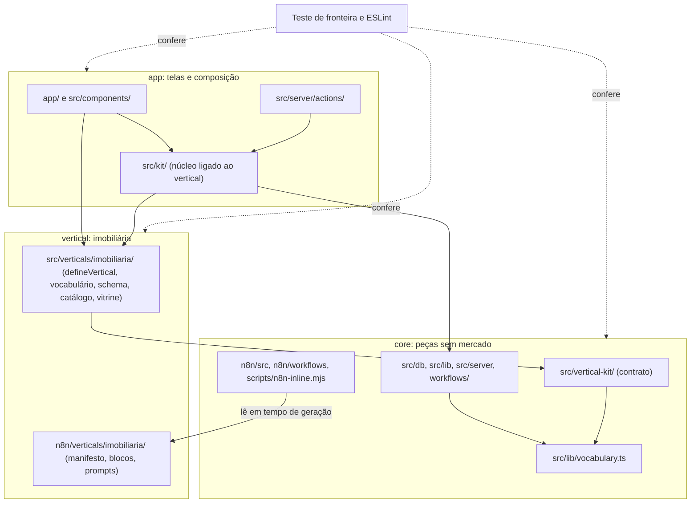
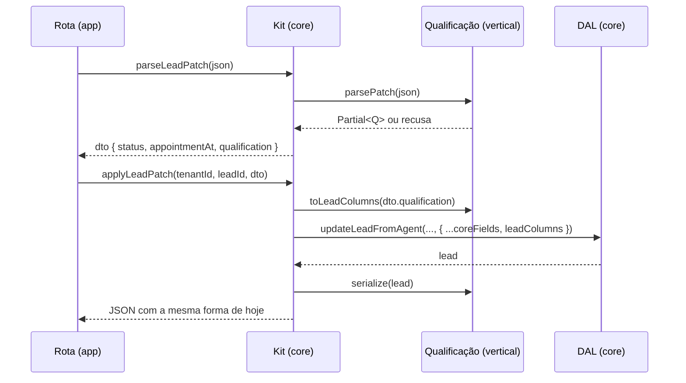

# Lote 18a — Costuras do núcleo — Design

**Spec**: `.specs/features/lote-18a-costuras-do-nucleo/spec.md`
**Context**: `.specs/features/lote-18a-costuras-do-nucleo/context.md`
**Decisão de arquitetura**: AD-052
**Commit de base**: `bf5e646`
**Status**: Approved (2026-11-02)

---

## Architecture Overview

Três camadas no pacote único. O núcleo não conhece vertical nem app; recebe o vertical por fábrica. O app é
quem junta os dois. O L18b só transforma essas camadas em pastas de workspace.



### Abordagens consideradas

**Como o vertical chega ao núcleo**

| Abordagem | Como funciona | Veredito |
| --- | --- | --- |
| **Fábrica nas peças que precisam (escolhida)** | `createAccess(vertical)`, `createIntegrationKit(vertical)`; o app guarda o resultado em `src/kit/` | Dependência explícita, sem estado global. Só as peças afetadas mudam |
| Registro global (`configureCore(vertical)`) | O app registra na inicialização, e o núcleo lê um singleton | Menos diff, mas falha em silêncio em cron, Vercel Workflow, scripts e testes, cada um com a própria carga de módulos |
| Alias de build (`@vertical`) | Cada app aponta o alias para o seu vertical | O núcleo importaria o vertical por outro nome, o que anula a fronteira |

**Como os workflows viram genéricos**

| Abordagem | Como funciona | Veredito |
| --- | --- | --- |
| **Blocos de texto no inliner (escolhida)** | A fonte genérica marca onde entra cada bloco do vertical; `n8n-inline.mjs` cola o texto e apaga as marcas | `n8n/generated/` fica idêntico e serve de prova. O pipeline, o README e a publicação não mudam |
| Função construtora em TS (`createPrincipal(agent)`) | Workflow vira função tipada, e a saída passa a ser JSON | Melhor para tipos, mas troca o pipeline inteiro e perde `n8n/generated/` como prova. Candidata para depois do L19 |

---

## Code Reuse Analysis

### Existing Components to Leverage

| Componente | Local | Como usar |
| --- | --- | --- |
| Função pura de permissão | `src/lib/permissions.ts:45` | A matriz vira a parte do núcleo em `createAccess`, com os mesmos valores |
| `problem()` e `TITLES` | `src/server/integration/problem.ts:76` | Vira método do kit; só `type` usa a marca |
| Parsers de campo | `src/server/integration/parsers.ts:291` | `optionalNullableField` é exportado e usado pelo parser de qualificação do vertical |
| Inliner determinístico | `scripts/n8n-inline.mjs` | Ganha blocos, condicionais e `--vertical`/`--out` |
| Teste de paridade com o `openapi.yaml` | `src/server/integration/__tests__/openapi.test.ts` | Continua sendo a prova do contrato |
| Scripts de banco de teste | `scripts/test-db-push.ts` | Comparação do schema ao lado deles |
| `generateDrizzleJson` | `node_modules/drizzle-kit/api.d.ts:3089` | Foto do schema sem banco e sem ambiente |

### Integration Points

| Sistema | Integração |
| --- | --- |
| Banco | Só muda a propriedade Drizzle; nome de coluna e valor gravado ficam iguais |
| `/api/v1` | A borda traduz o símbolo interno para o nome atual do fio (`appointmentAt` para `meetingAt`) |
| n8n | Só muda o caminho das fontes; nada é publicado |
| `vitrine/` | Não muda; continua lendo as views e o papel do banco |

---

## Components

### 1. Verificador de fronteira

- **Purpose**: Reprovar por máquina todo desvio da separação.
- **Location**: `scripts/boundary/`
  - `map.json`: regras por glob em ordem, com `layer` e `package`. Exemplo: `{ "glob": "src/server/integration/properties.ts", "layer": "vertical" }`, antes de `{ "glob": "src/server/**", "layer": "core", "package": "@core/server" }`.
  - `transitional.json`: exceções, cada uma com `path`, `term`, `reason` e `removedIn`.
  - `portuguese-terms.json`: lista de palavras da checagem de identificadores.
  - `check.ts`: funções puras `checkClassification`, `checkImports`, `checkMarketTerms`, `checkStoredValues` e `checkIdentifiers`.
  - `scripts/__tests__/boundary.test.ts`: roda as cinco sobre a árvore real e sobre fixtures que provam cada reprovação.
- **Interfaces**: cada `check*` devolve `Violation[]` com `{ file, line, message }`.
- **Como funciona**: `ts.createSourceFile` dá o AST. Imports saem das declarações `import` e `export from`, com `@/` e caminho relativo resolvidos. Termos de mercado olham identificadores e literais, sem comentários. A checagem de identificadores quebra camelCase e snake_case e compara com a lista.
- **ESLint**: `eslint.config.mjs` lê `map.json` e monta um bloco `no-restricted-imports` por camada. O teste cobre o que o padrão de glob do ESLint não enxerga, como caminho relativo profundo.
- **Reuses**: `typescript`, já dependência de desenvolvimento.

**Classificação inicial**

| Caminho | Camada | Pacote |
| --- | --- | --- |
| `src/db/schema.ts`, `index.ts`, `test-connection.ts`, `mint-service-key.ts`, `revoke-service-key.ts`, `create-admin.ts` | core | `@core/db` |
| `src/db/seed.ts`, `smoke-reset.ts` | vertical | |
| `src/vertical-kit/**` | core | `@core/vertical-kit` |
| `src/lib/**`, `src/stores/**`, fora os de vitrine | core | `@core/client` |
| `src/lib/storefront*.ts` | vertical | |
| `src/server/auth`, `chats`, `data`, `documents`, `integration`, `reengagement`, `whatsapp`, `tenant.ts`, `validation.ts`, `workflows/**` | core | `@core/server` |
| `src/server/integration/properties.ts`, `property-filters.ts`, `src/server/storefront/**`, `src/server/data/storefront.ts` | vertical | |
| `src/verticals/imobiliaria/**`, `n8n/verticals/imobiliaria/**` | vertical | |
| `n8n/src/**`, `n8n/workflows/**`, `n8n/generated/**`, `scripts/n8n-inline.mjs` | core | `@core/agent` |
| `app/**`, `src/components/**`, `src/kit/**`, `src/server/actions/**`, `proxy.ts` | app | |
| `scripts/vitrine*`, `scripts/document-context-benchmark.ts`, `scripts/document-folders/**` | vertical | |
| demais `scripts/**` | core | `@core/db` |

O Tasks fecha a classificação arquivo a arquivo; o teste reprova o que sobrar.

### 2. Vocabulário

- **Purpose**: Dar nome em inglês a cada valor gravado, com a troca do L18c concentrada em poucos arquivos.
- **Location**: `src/lib/vocabulary.ts` (núcleo) e `src/verticals/imobiliaria/vocabulary.ts` (domínio).
- **Interfaces**:

```ts
export const LEAD_STATUS = {
  engaged: "em_qualificacao",
  goal_reached: "qualificado_agendado",
  escalated: "escalado_humano",
} as const;
export type LeadStatus = (typeof LEAD_STATUS)[keyof typeof LEAD_STATUS];

export const ROLE = { admin: "administrador", manager: "gestor", attendant: "corretor" } as const;
export const AGENT_PHASE = { qualifying: "qualificando", closing: "agendando", ended: "encerrada" } as const;
export const SENDER = { agent: "agente", lead: "lead", human: "humano" } as const;
export const STATUS_ACTOR = { human: "humano", agent: "agente" } as const;
export const INTEGRATION_HEALTH = { healthy: "saudavel", problem: "problema" } as const;
export const DOCUMENT_STATUS = { processing: "processando", ready: "pronto", failed: "falha", outside_agent: "fora_do_agente" } as const;
export const HUMAN_SEND_STATE = { sending: "enviando", sent: "enviada", failed: "falhou" } as const;
export const PROBLEM_CODE = { appointment_conflict: "conflito-de-agenda", no_assignee_available: "sem-corretor-disponivel" /* e os demais de problem.ts:20 */ } as const;
```

- **Uso**: `pgEnum` e a tabela `TRANSITIONS` passam a ler as constantes. Telas usam chave computada: `{ [LEAD_STATUS.engaged]: "Em qualificação" }`, o que mantém `Record<LeadStatus, string>` e a L-029.
- **Alcance medido**: literais em arquivos não teste, 36 arquivos e 164 linhas de vocabulário do núcleo; 22 arquivos e 147 linhas de domínio.
- **Testes**: não mudam. Eles seguem afirmando `"corretor"`, e essa é a prova de que o valor não mudou.

### 3. Contrato do vertical

- **Purpose**: Dizer em um tipo tudo o que o núcleo precisa saber.
- **Location**: `src/vertical-kit/index.ts`, sem dependência além do vocabulário e seguro para o navegador.
- **Interfaces**:

```ts
export interface VerticalBrand {
  name: string;          // "Krivo"
  problemUrn: string;    // "krivo", em urn:krivo:problem:<code>
  tenantHeader: string;  // "X-Krivo-Tenant"
  alertTag: string;      // "krivo", no assunto do alerta de integração
}

export interface VerticalResource {
  name: string;
  permissions: Record<Role, readonly Action[]>; // sem um papel, não compila
}

export interface QualificationFacet<Q, Wire> {
  parsePatch(json: Record<string, unknown>): ParseResult<Partial<Q>>;
  serialize(row: LeadQualificationRow): Wire;        // mesmos campos e mesma ordem do fio
  toLeadColumns(q: Partial<Q>): LeadQualificationColumns;
  promptFacts(row: LeadQualificationRow): Record<string, unknown>; // reengajamento
}

export interface DocumentSegmentsFacet {
  values: readonly string[];
  matches(documentSegment: string, querySegment: string): boolean;
}

export interface Vertical<Q = unknown, Wire = unknown> {
  id: string;
  brand: VerticalBrand;
  resources: readonly VerticalResource[];
  appointments: boolean;
  qualification: QualificationFacet<Q, Wire> | null;
  documentSegments: DocumentSegmentsFacet | null;
}

export function defineVertical<Q, Wire>(v: Vertical<Q, Wire>): Vertical<Q, Wire>;
```

- **Validação**: `defineVertical` lança erro em `id` vazio e em recurso que colida com um recurso do núcleo.
- **Por que `agent` não está aqui**: `src/components/shell/sidebar.tsx` é client component e usa `can`. Com prompts no contrato, eles entrariam no bundle do navegador.
- **`LeadQualificationRow`**: tipo das colunas transitórias de `leads`. É a única menção delas fora do schema, listada em `transitional.json` e removida no L18c.

### 4. Kit do app

- **Purpose**: Ligar o núcleo ao vertical em um lugar só.
- **Location**: `src/kit/access.ts`, seguro para o navegador, e `src/kit/integration.ts`, só servidor.
- **Interfaces**:

```ts
// src/kit/access.ts
export const { can, RESOURCES } = createAccess(imobiliaria);

// src/kit/integration.ts
export const {
  problem, methodNotAllowed, authenticateIntegration,
  parseLeadPatch, serializeLead, applyLeadPatch,
} = createIntegrationKit(imobiliaria);
```

- **Efeito**: os 35 arquivos que importam `problem` e as rotas trocam o caminho do import. Tela e action não veem a fábrica.
- **Testes**: mudam só o caminho do import (KEEP-04 AC2).

### 5. Permissões compostas

- **Location**: `src/lib/access.ts`, no lugar de `src/lib/permissions.ts`.
- **Interfaces**: `createAccess(vertical)` devolve `can(roles, resource, action)` e `RESOURCES`.
- **Regra**: a matriz fica fechada na criação. Recurso desconhecido recebe `false`. Ações `read`/`write`.
- **Teste de paridade (VOCAB-03 AC2)**: tabela literal da matriz de `bf5e646` no teste, com de-para `documentos`→`documents`, `configuracoes`→`settings`, `usuarios`→`users`, `imoveis`→`catalog`, `ler`→`read`, `escrever`→`write`, conferida célula a célula.

### 6. Costura da qualificação e kit de integração

- **Purpose**: Tirar do núcleo os 8 campos da imobiliária, sem mudar o fio.
- **Location**: `src/server/integration/kit.ts` (núcleo) e `src/verticals/imobiliaria/qualification.ts`.
- **Fluxo do `PATCH /leads/{id}`**:



- **Ordem do fio**: `serializeLead` espalha o resultado de `serialize` entre `status` e `executiveSummary`, na ordem de `src/server/integration/leads.ts:97`.
- **Ordem das validações**: `parseLeadPatch` valida hoje `status`, os campos de texto e os demais em sequência, e a primeira falha define o `detail`. Testes de contrato cobrem essa ordem; onde não cobrirem, a T de costura acrescenta um caso antes de mover o código (L-042).
- **Telas**: `getLeads` e `getRecentLeads` (`src/server/data/index.ts:250`, `:302`) selecionam os campos de qualificação. Elas recebem a seleção por parâmetro, passada pelo app, com o mesmo SQL.
- **Dashboard**: `getLeadDistributions` (`:1115`) conta por `modality`. Vai para `src/verticals/imobiliaria/data/distributions.ts`, porque só a tela da imobiliária a usa.

### 7. Agendamento opcional

- **Purpose**: Renomear para `appointment` e `assignee`, com chave por vertical.
- **Renomeações**: `assignBrokerForMeeting`→`assignForAppointment`, `assignBrokerForEscalation`→`assignForEscalation`, `getBrokers`→`getAssignees`, `getBrokerLoads`→`getAssigneeLoads`, `getBrokerCandidates`→`getAssigneeCandidates`, `getBrokerContact`→`getAssigneeContact`, `updateLeadBroker`→`updateLeadAssignee`, `setMeetingAttendance`→`setAppointmentAttendance`, `getPendingAttendanceMeetings`→`getPendingAttendanceAppointments`, `getUpcomingMeetingsOfMember`→`getUpcomingAppointmentsOfMember`, `selectForMeeting`→`selectForAppointment`; `src/lib/broker-assignment.ts`→`assignee-assignment.ts`, `broker-availability.ts`→`assignee-availability.ts`, `meeting-attendance.ts`→`appointment-attendance.ts`.
- **Coluna**: `appointmentAt: timestamp("meeting_at", ...)`, e igual para `appointmentAttended`, `appointmentDays`, `appointmentHoursStart`, `appointmentHoursEnd`, `baselineLeadToAppointmentPct`.
- **Borda**: `parseLeadPatch` lê `meetingAt` e grava `dto.appointmentAt`; `serializeLead` faz o inverso, e `/settings` também. A resposta mantém `assignedBroker`.
- **Com `appointments: false`**:
  - `parseLeadPatch` recusa `meetingAt` com o mesmo `payload-invalido` de hoje;
  - `getPendingAttendanceAppointments` e as métricas de comparecimento devolvem lista vazia, recebendo a chave por parâmetro;
  - `TRANSITIONS` não muda: `engaged` para `goal_reached` não exige horário nem hoje.

### 8. Schema, catálogo e vitrine

- **Location**: `src/db/schema.ts` continua no lugar e fica só com o núcleo, o que preserva os 157 imports relativos existentes. `src/verticals/imobiliaria/schema.ts` recebe `properties`, `tenantStorefronts`, `propertyKindEnum`, `propertyStatusEnum`, `storefrontLayoutEnum` e `storefrontFontEnum`.
- **Transitório em `src/db/schema.ts`**: as colunas de qualificação de `leads` e os enums `modality`, `property_type`, `motivation` e `credit_status`, listados em `transitional.json` com remoção no L18c.
- **Drizzle**: `drizzle.config.ts` e `drizzle-test.config.ts` passam a `schema: [núcleo, vertical]`. `src/db/index.ts` não precisa do `schema` no `drizzle(...)`, porque não há uso de `db.query.`.
- **DAL**: `getProperties`, `createProperty`, `updateProperty`, `deleteProperty` e `setPropertyFeatured` (`src/server/data/index.ts:702-914`) vão para `src/verticals/imobiliaria/data/properties.ts`.
- **Foto do schema**: `scripts/boundary/schema-snapshot.ts` usa `generateDrizzleJson`, ordena as chaves e zera `id`/`prevId`. A foto de `bf5e646` fica em `scripts/boundary/schema-baseline.json`, gerada antes de qualquer mudança. O teste compara com o estado atual.

### 9. Segmentos de documento

- **Renomeações de símbolo**: `documents.segment` (coluna `modality`), `tenants.supportedSegment` (coluna `supported_modality`), `tenantDocumentContextLimits.querySegment`, `DocumentModality`→`DocumentSegment`.
- **Borda**: `POST /context` continua lendo `modality`.
- **Com `documentSegments: null`**: o contexto ignora o filtro e entrega todos os documentos admitidos. A admissão e o teto por segmento tratam o tenant como um segmento único. A coluna é `notNull` até o L18c, então o vertical de teste grava um valor fixo do enum atual.
- **Fora daqui**: `leads.modality` e `properties.modality` são qualificação e catálogo e mantêm o nome, que já é inglês.

### 10. Gerador do agente

- **Purpose**: Gerar os workflows de qualquer vertical, com o texto da imobiliária idêntico.
- **Location**:
  - `n8n/workflows/*.ts`: fontes genéricas;
  - `n8n/src/*.mjs`: módulos genéricos, inclusive `agendamento.mjs`, que só entra com agendamento ligado;
  - `n8n/verticals/imobiliaria/agent.mjs`: manifesto;
  - `n8n/verticals/imobiliaria/blocks/*.ts`: trechos de código SDK com texto de mercado;
  - `n8n/verticals/imobiliaria/src/*.mjs`: `system-message.mjs`, `phase.mjs`, `reengagement-prompt.mjs`, `benchmark-corpus.mjs`.
  - `n8n/verticals/imobiliaria/workflows/benchmark-contexto.ts`: workflow que só existe para a imobiliária.
- **Marcas novas no inliner**, todas apagadas na geração:

```ts
const CRM_BASE_URL = "__VALUE(crmBaseUrl)__";   // troca só o miolo da string
// __BLOCK(search-catalog-tool)__               cola n8n/verticals/<id>/blocks/search-catalog-tool.ts
// __IF(appointments)__ ... // __ENDIF__        mantém ou remove o trecho
```

  `__VALUE` cobre URL, ids de workflow e de Data Table e os exemplos `output:` que hoje citam `imobiliaria-a` nas fontes genéricas. `__BLOCK` cobre o que é trecho inteiro de código.

- **Manifesto**:

```js
export const agent = {
  id: "imobiliaria",
  appointments: true,
  values: { crmBaseUrl: "...", sampleTenantSlug: "imobiliaria-a", conversationStateTableId: "..." /* ... */ },
  blocks: ["qualification-tool", "escalation-tool", "documents-tool", "search-catalog-tool", "agent-tools-list" /* ... */],
  workflows: ["erros", "principal", "reengagement-contextual", "scheduler", "smoke-memoria", "smoke-reset", "tool-agendar-reuniao", "tool-responder-lead"],
};
```

- **Regras do inliner**:
  - bloco referenciado e ausente: erro com o nome;
  - bloco no manifesto sem referência: erro;
  - `__VALUE` sem valor no manifesto: erro;
  - workflow fora de `workflows` não é gerado, e é assim que o vertical sem agendamento omite `tool-agendar-reuniao`;
  - mesmo módulo nas pastas genérica e do vertical: erro (AGENT-02 AC2);
  - `__IF` sem `__ENDIF`: erro;
  - a saída continua em um arquivo só, com um import do SDK, e o CRLF continua normalizado.
- **Prova**: `git diff bf5e646 -- n8n/generated/` vazio. O teste compara hashes de `n8n/generated/` com `scripts/boundary/generated-hashes.json`, gerado em `bf5e646`.
- **Testes dos workflows**: 19 arquivos importam a fonte (`../principal`) e chamam `toJSON()`. Como a fonte perde blocos, eles passam a importar `../../generated/principal`, o que testa o que é publicado. A busca por `jsCode).toContain` e semelhantes achou 2 asserções, e os marcadores `__INLINE` só aparecem em `scripts/__tests__/n8n-inline.test.ts`; a primeira rodada contra `generated` confirma se há outras. Os testes de módulo mudam o caminho de `system-message.mjs` e `phase.mjs`.
- **Vertical de teste**: `n8n/verticals/__fixture__/`, com blocos mínimos e sem agendamento. O teste gera em pasta ignorada pelo Git, importa e confere o `toJSON()` (AGENT-01 AC3 e AC4).
- **Fora do L18a**: identificadores em português dentro de `n8n/`, porque mudariam o texto publicado. `transitional.json` cita `n8n/src/**` e `n8n/workflows/**` por inteiro.

### 11. Vertical de teste do núcleo

- **Location**: `src/vertical-kit/__tests__/fixture-vertical.ts`.
- **Conteúdo**: marca `Acme`, sem recursos extras, `appointments: false`, `qualification: null`, `documentSegments: null`.
- **Prova (VERT-03)**: um arquivo de teste por grupo de peças (lead, conversa, mensagem, documento, permissão, LGPD), no banco de teste. Um caso confere pelo mapa de fronteira que o grafo de imports desses testes não alcança `src/verticals/imobiliaria/`.

### 12. Identificadores em inglês

- **Purpose**: Tirar o português dos símbolos fora de `n8n/`.
- **Levantamento inicial**, a fechar no Tasks pelo verificador:
  - `src/components/usuarios/`→`src/components/users/`;
  - páginas `ConfiguracoesPage`, `DocumentosPage`, `ImoveisPage`, `UsuariosPage`;
  - `normalizarBaseDaVitrine`, `avisarVitrine`, `HORIZONS_NOVO`, `HORIZONS_USADO`;
  - `scripts/vitrine-e2e.ts` (40 ocorrências), `scripts/vitrine-fixture.ts`, `scripts/vitrine-dev.ts`.
- **Mantido por `transitional.json`**: pastas de rota como `app/(crm)/imoveis`, chaves do fio como `precoMin`, `bairro` e `modalidade`, e `n8n/`.

---

## Data Models

Sem DDL. O que muda é o nome da propriedade Drizzle:

```ts
export const leads = pgTable("leads", {
  status: leadStatusEnum("status").notNull(),
  appointmentAt: timestamp("meeting_at", { withTimezone: true }),
  appointmentAttended: boolean("meeting_attended"),
  // transitório até o L18c (transitional.json)
  modality: modalityEnum("modality"),
  budgetCents: bigint("budget_cents", { mode: "bigint" }),
  // ...
});
```

Índices e checks citam colunas pelo objeto da tabela, então o nome em SQL não muda. O índice `leads_assigned_user_id_meeting_at_idx` mantém o nome.

---

## Error Handling Strategy

| Cenário | Tratamento | Quem vê |
| --- | --- | --- |
| Arquivo sem classificação, import proibido, termo ou identificador fora da regra | Teste de fronteira falha com arquivo e linha | Desenvolvedor, no `npm test` |
| `defineVertical` inválido | Lança na carga do módulo; o build falha | Desenvolvedor |
| Campo de qualificação ou de agendamento com vertical sem o recurso | `payload-invalido`, como em `parseLeadPatch` hoje | Agente, pelo `/api/v1` |
| Bloco ou módulo ausente ou duplicado no inliner | Geração falha com o nome | Desenvolvedor |
| `n8n/generated/` diferente da referência | Teste falha com arquivo e linha | Desenvolvedor |
| Recurso desconhecido em `can` | `false` | Usuário vê acesso negado |

---

## Risks & Concerns

| Concern | Location (file:line) | Impact | Mitigation |
| --- | --- | --- | --- |
| Renomear e mover no mesmo commit apaga o histórico | Todo o lote | `git blame` e revisão ficam ruins | Movimento de arquivo em commit próprio, antes da edição |
| Constante errada troca um valor gravado sem erro de compilação | `src/lib/vocabulary.ts` | Grava valor fora do enum | Teste afirma o par chave e valor de cada constante; os testes de valor continuam literais |
| Rename automático altera string do fio | `src/server/integration/parsers.ts:387`, `leads.ts:82` | Muda o contrato sem aviso | `openapi.test.ts` e os testes de rota; `git diff` do `openapi.yaml` vazio |
| Literal em SQL escapa do compilador | `src/server/data/index.ts:204`, `:2959` | Predicado de papel não casa | VOCAB-01 AC6, com teste de banco; `checkStoredValues` também olha os templates `sql` |
| DAL monolítico de 3.365 linhas continua inteiro | `src/server/data/index.ts` | Conflitos de merge e arquivo difícil | Só sai o que é do vertical. Dividir fica fora deste lote |
| Actions com lógica ficam no app | `src/server/actions/users.ts`, `documents.ts`, `deactivate.ts` | O L19 copiaria cerca de 1.500 linhas | Classificadas como `app` no L18a. O spec do L19 promove a peças o que ele usar de fato |
| `tenants.supported_modality` é `notNull` com enum da imobiliária | `src/db/schema.ts:140` | Vertical sem segmentos não tem valor natural | Transitório; o L18c torna a coluna opcional e genérica |
| Spec de VERT-03 precisa do banco de teste compartilhado | `test-workers.local.json` | Contaminação entre suítes (L-033) | Uma suíte por vez, regra já vigente |
| Teste dos workflows passa a depender de `n8n/generated/` atualizado | `n8n/workflows/__tests__/` | Fonte editada sem regenerar passa no teste antigo | Teste novo regenera em memória e compara com o arquivo em disco |
| `generateDrizzleJson` pode variar com a ordem dos arquivos | `node_modules/drizzle-kit/api.d.ts:3089` | Falso positivo na foto | Chaves ordenadas. Não verifiquei o formato na prática; a primeira task confirma, e o plano B é `drizzle-kit export` com linhas ordenadas |
| `actions.test.ts` fica vermelho por timeout com a branch acumulada | Dívida do L17 | Suíte falha sem relação com o lote | Regra já registrada: rodar depois de `seed.test.ts` e não atribuir ao lote |
| Worktrees antigos do orquestrador podem ter mudanças | `crivo-3`, `crivo-7` | Merge posterior difícil depois deste refactor | Conferir antes do Execute se ainda têm valor |

---

## Tech Decisions

| Decisão | Escolha | Por quê |
| --- | --- | --- |
| Entrega do vertical | Fábrica nas peças afetadas, guardada em `src/kit/` | Explícita, testável com outro vertical e sem estado global |
| Valores gravados | Constantes com a chave futura, sem tradução em execução | Nada novo no caminho de dados |
| Workflows genéricos | Blocos de texto no inliner | Mantém o pipeline, e `n8n/generated/` vira a prova |
| Manifesto do agente separado do contrato | `n8n/verticals/<id>/agent.mjs` | O contrato chega ao navegador pela `sidebar` |
| Actions | Camada `app` no L18a | Server actions não saem bem de fábrica, e a promoção fica para quando o L19 mostrar o que reusa |
| Local do contrato | `src/vertical-kit/` | Corresponde a `@core/vertical-kit` e move sem editar no L18b |
| Prova do agente | Hash de `n8n/generated/` | Sem cópia duplicada de arquivos grandes no repositório |

Nenhuma decisão nova de projeto além da AD-052.

---

## Ordem de execução sugerida

Cada etapa deixa a suíte verde, e o Tasks detalha:

1. Fotos de referência em `bf5e646` (schema e hashes) e verificador de fronteira com `transitional.json` amplo.
2. Vocabulário e constantes, sem mudar valor.
3. Contrato, vertical da imobiliária e vertical de teste.
4. Permissões e kit de integração, com a marca.
5. Movimentos: schema, catálogo, vitrine, qualificação e segmentos.
6. Renomeações de agendamento e atribuição, depois identificadores em inglês.
7. Gerador do agente, com blocos.
8. Encolher `transitional.json` ao que é do L18c, capturas de tela e Verifier.

---

## O que este lote deixa para os próximos

- **L18b**: `map.json` já diz o destino de cada arquivo, e `src/kit/`, `src/verticals/` e `src/vertical-kit/` movem sem edição.
- **L18c**: `transitional.json` é a lista de trabalho. Os valores trocam nos dois módulos de vocabulário, com o DDL, a tabela 1:1 de qualificação, o `/api/v1` nos dois vocabulários, o agente renomeado e republicado, as pastas e URLs com redirecionamento, `title`/`detail` do fio e `vitrine/`.
